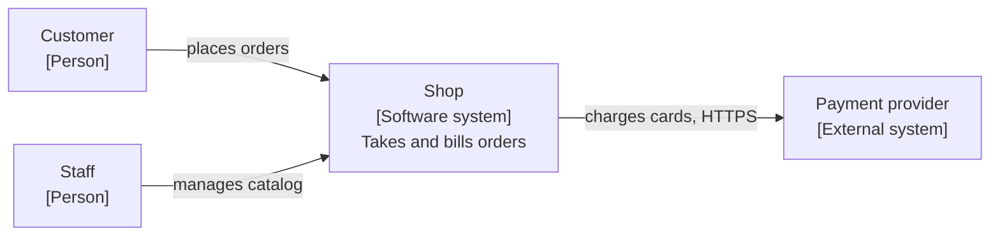
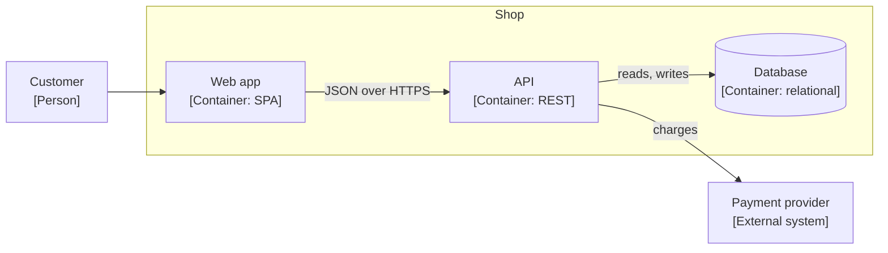
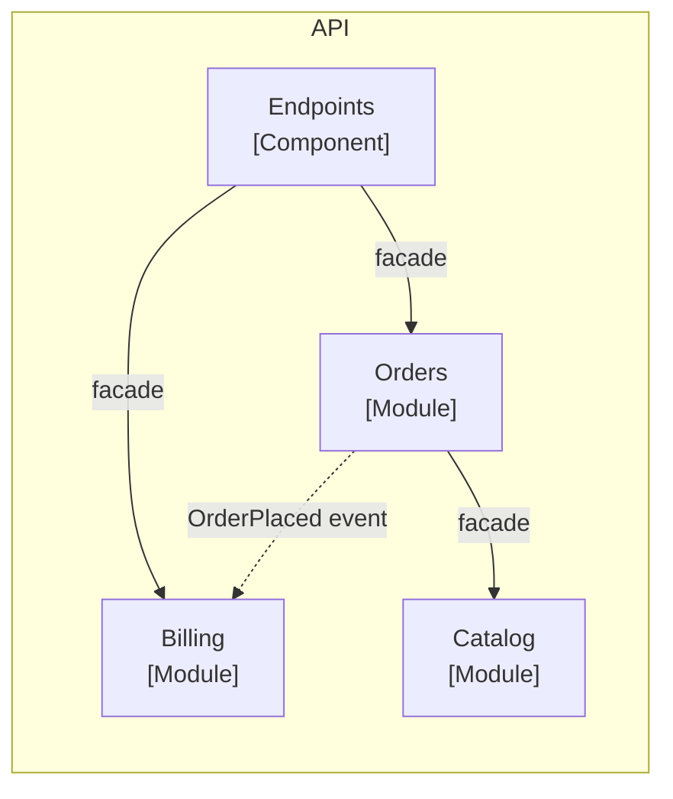

# Architecture

If the project has `.agents/overrides/rs-architecture.md`, read it first. Where it conflicts with this skill, it wins.

ARCHITECTURE.md is the current map of how the project is built, with C4 diagrams for levels 1 to 3: context, containers and components. ADRs say why. Architecture tests make the rules hard.

## Steps

1. **Context.** Read AGENTS.md, ARCHITECTURE.md if it exists, the ADRs, the specs and the code structure: solution or package layout, folders, references between parts.
2. **Draft.** For existing code, write the map as the code shows it and mark every guess `???`. For a new project, start empty.
3. **Interview.** Ask in rounds of at most five questions, numbered `Q1` and onward, using the topics below. Stop after each round and wait for the answers. Never answer them yourself. The user may answer that a topic does not apply; write `Not applicable` under it. Where the code breaks a rule the user wants, list the violations; never describe them as the rule.
4. **Decisions.** Record each decision with rs-architecture-decision, one ADR per decision, `Accepted` when the user confirmed it.
5. **Map.** Write ARCHITECTURE.md from the template, at the project root unless the project keeps docs elsewhere. Draw the diagrams as described below. Link each rule to its ADR.
6. **Enforcement.** For each rule, propose an automated check: an architecture test library for the stack, a dependency linter, a script. Show the list. With the user's OK, write the checks and add them to the validation gate. Rules no tool can check go under `Checked by review`.
7. **Existing violations.** If checks fail on the current code, list the violations and ask: fix now, or allowlist each with a reason and a link to a follow-up. Never weaken a rule to make it pass.
8. **Pointer.** Add to the project's AGENTS.md, outside any generated block:

   ```markdown
   ## Architecture

   Read ARCHITECTURE.md before adding or moving code. Never reach into another module's internals.
   ```

9. **Approve.** Show the map, the ADRs and the checks. Iterate until the user approves.

## Interview topics

- **Context.** Who uses the system, which external systems it talks to and why.
- **Containers.** What gets deployed or run separately: API, web app, database, queue, jobs. Technology and protocol between them.
- **Style.** One deployable or several? Modular monolith, layered, services?
- **Modules.** Which parts exist, what each owns: concepts, data, workflows. Use the words from the specs.
- **Public surface.** What each module exposes: facade, commands, queries, events. What stays internal.
- **Dependencies.** Which module may use which. What must never depend on what.
- **Communication.** Direct facade calls, commands with handlers, queries, events, queues. When each one.
- **Entry points.** REST API, UI, jobs, CLI. How each reaches the modules.
- **Layers.** Inside a module: domain, application, infrastructure or other. Dependency direction.
- **Data.** One database or per module, shared tables allowed, who writes what.
- **Cross-cutting.** Authentication, authorization, errors, logging, transactions, configuration.
- **Contracts.** Which surfaces are public and how they may change: frozen, additive only, versioned.
- **Placement.** Where each kind of code goes.

## Template

````markdown
# Architecture

## Style

Modular monolith, one deployable. ([ADR-0001](docs/adr/0001-modular-monolith.md))

## Context



## Containers



## Components

### API



| Module  | Owns                          | Public surface        |
|---------|-------------------------------|-----------------------|
| Orders  | orders, order lines, statuses | OrdersFacade, events  |
| Billing | invoices, payments            | BillingFacade         |

Only the arrows drawn are allowed. Modules never reference each other's internals or data.

## Communication

- Each endpoint calls one facade method. (ADR-0002)
- Writes are commands with one handler each; reads are queries. (ADR-0003)

## Layers

Domain <- Application <- Infrastructure. Domain depends on nothing.

## Data

## Cross-cutting

## Contracts

| Surface | Rule |
|---------|------|
| REST API | Additive only; breaking changes need a new version |

## Placement

| Code | Location |
|------|----------|
| Endpoint | Api/<Module>/ |
| Command and handler | <Module>/Application/Commands/ |

## Enforced by

| Rule | Check |
|------|-------|
| Modules use only each other's facades | ArchitectureTests.Modules_use_only_facades |

## Checked by review

Rules no tool checks, with the reason.
````

## Diagrams

- C4 levels 1 to 3 only: context, containers, components. Never classes or code.
- Mermaid flowcharts, so they render in place and diff as text. Each node says its name, its kind in brackets and, where useful, its technology or responsibility.
- Label every arrow with what flows and, between containers, how, such as JSON over HTTPS.
- Solid arrows are calls, dashed arrows are events or messages.
- One component diagram per container that has modules. At most about 15 nodes per diagram; split if larger.
- The component diagram is the dependency rule: an arrow not drawn is not allowed.

## Rules

- ARCHITECTURE.md describes the present, never plans. Plans go in specs.
- Every rule in it links an accepted ADR.
- Keep it under two screens. Details go in the ADRs.
